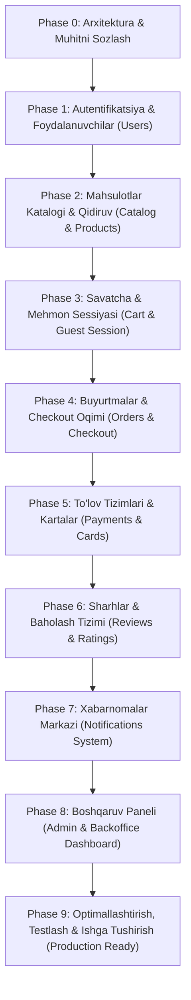
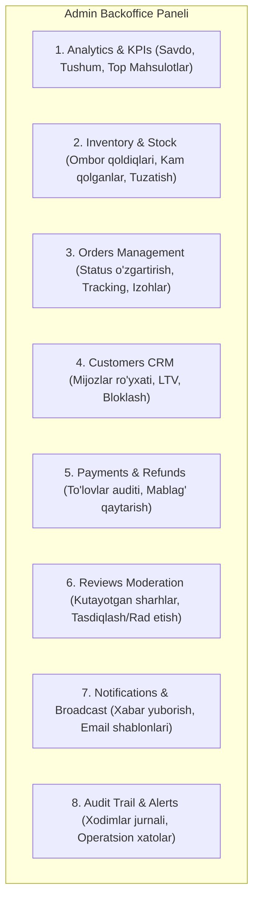
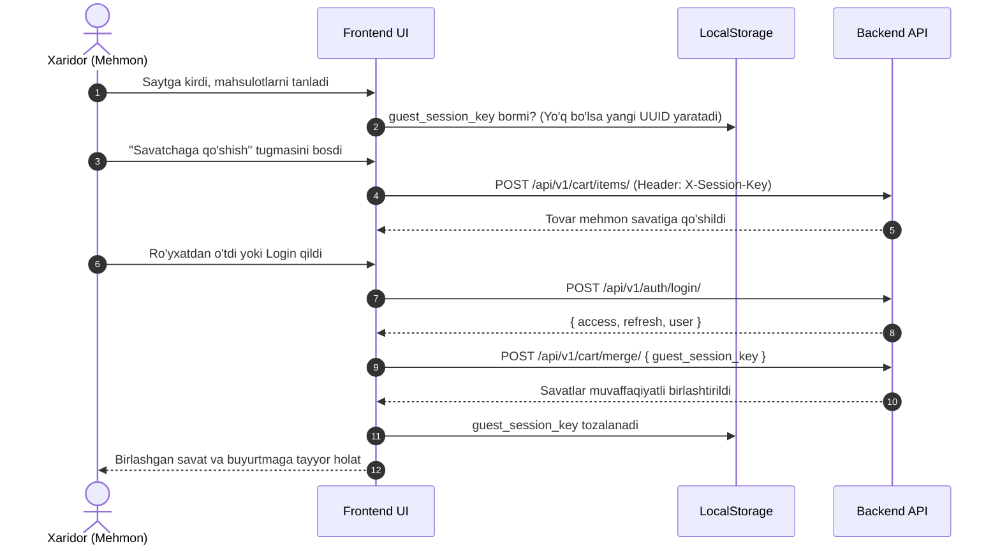
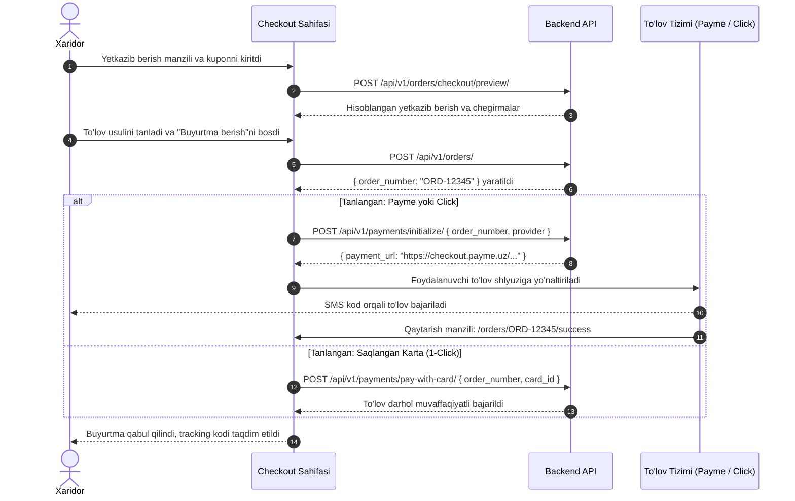

# E-Commerce Frontend Loyihasini Qurish Rejasi (Master Roadmap)

Mazkur hujjat backend REST API to'plami ([`postman/ecommerce_api_collection.json`](file:///postman/ecommerce_api_collection.json)) asosida zamonaviy, to'liq funksional, xavfsiz va yuqori unumdorlikka ega elektron tijorat frontend platformasini noldan bosqichma-bosqich qurish uchun batafsil arxitektura va amaliy rejani o'z ichiga oladi.

---

## 1. Loyiha Haqida va Asosiy Talablar

Ushbu platforma 2 ta asosiy qismdan iborat bo'ladi:
1. **Customer Storefront (Mijozlar do'koni)**:
   - Ro'yxatdan o'tish va OTP orqali kirish
   - Kategoriyalar daraxti, brendlar, fasetli filtrlar va tezkor qidiruv
   - Mehmon va ro'yxatdan o'tgan foydalanuvchilar savatchasi (Cart)
   - Checkout oqimi: yetkazib berish manzili, kupon/promokod, hisob-kitob predprosmotri
   - To'lov tizimlari: Payme, Click, saqlangan bank kartalari orqali 1-bosishda to'lov
   - Buyurtmalar tarixi, buyurtmani kuzatish (tracking timeline), invoys (cheklar)
   - Mahsulot sharhlari, rasm yuklash va ovoz berish
   - Xabarnomalar markazi (real-time / unread badge)
2. **Backoffice / Admin Dashboard (Boshqaruv paneli)**:
   - Boshqaruv statistikasi va moliyaviy KPI lar (Recharts grafikalari)
   - Ombor va zaxira (Inventory) boshqaruvi: kam qolgan tovarlar, qoldiqni qo'lda o'zgartirish, audit jurnali
   - Buyurtmalar nazorati, status o'zgartirish, kuryer kuzatuv kodi va ichki eslatmalar (Internal notes)
   - Mijozlar CRM: xaridorlar ro'yxati, LTV (Lifetime Value), bloklash/faollashtirish
   - To'lovlar monitoringi va mablag'ni qaytarish (Refunds)
   - Sharhlar moderatsiyasi va rasmiy javob qaytarish
   - Xabarnoma shablonlari (Templates), ommaviy bildirishnomalar (Broadcast), Email navbati monitoringi
   - Tizim operatsion ogohlantirishlari (Alerts) va xodimlar harakati auditi (Audit logs)

---

## 2. Texnologik Stack (Tech Stack Selection)

| Qatlam | Tanlangan Texnologiya | Asoslash va Afzalliklari |
| :--- | :--- | :--- |
| **Framework** | **Next.js 15+ (App Router)** | SEO optimizatsiyasi, SSR/SSG/ISR, tezkor sahifalash, Storefront va Admin qismlarini bitta monolit-loyihada alohida Route Grouplarda (`(storefront)` va `(admin)`) boshqarish qulayligi |
| **Dasturlash tili** | **TypeScript 5+** | 100% typesafety, xatoliklarni kompilyatsiya vaqtida aniqlash, OpenAPI 3.0 schema asosida backend tiplarini avtomatlashtirish |
| **Styling & UI Kit** | **Tailwind CSS v4** + **shadcn/ui** (Radix UI) | Kichik hajm, to'liq moslashtiriladigan (unopinionated) qismlar, qulay accessibility (a11y), responsive dizayn |
| **Ikonkalar & Animatsiya** | **Lucide React** + **Framer Motion** | Yengil zamonaviy ikonkalar, silliq modal, drawer va sahifa o'tishlari |
| **Server State & Kesh** | **TanStack React Query v5** | API so'rovlarni keshlash, avtomatik refetch, optimistic updates, pagination va infinite scroll qulayligi |
| **Client Global State** | **Zustand** | Yengil, sodda va tezkor client holati (mehmon `guest_session_key`, auth tokenlar, savatcha paneli holati, modal oynalar) |
| **Formalar & Validatsiya** | **React Hook Form** + **Zod** | Yuqori unumdorlik, qayta chizilishlarni kamaytirish, mukammal schema-validatsiya |
| **Grafiklar (Charts)** | **Recharts** | Dashboard tahlillari, sotuv dinamikasi va tushumlar vizualizatsiyasi |
| **HTTP Mijoz** | **Axios** (yoki **ky**) | Interceptors: JWT Bearer tokenni biriktirish, 401 bo'lganda tokenni avtomatik yangilash (`token/refresh/`), mehmonlar uchun `X-Session-Key` sarlavhasini qo'shish |
| **Xabarnomalar (Toasts)** | **Sonner** | Foydalanuvchiga operatsiyalar natijalarini ko'rsatuvchi zamonaviy toastlar |
| **Sana & Vaqt** | **date-fns** | Xalqaro va mahalliy formatdagi sana/vaqt amallari |

---

## 3. Loyiha Arxitekturasi va Papkalar Strukturasi

Next.js 15 App Router tizimida **Feature-driven Architecture** (funksional modullar asosida) tuzilma tanlanadi:

```text
ecommerce-web/
├── docs/                                  # Hujjatlar va spetsifikatsiyalar
│   ├── frontend-implementation-plan.md    # Ushbu master reja
│   └── api-contracts.md                   # OpenAPI va interfeyslar qoralamasi
├── postman/                               # Backend Postman collection va qo'llanma
│   ├── ecommerce_api_collection.json
│   └── README.md
├── public/                                # Statik rasmlar, favikonlar, bannerlar
└── src/
    ├── app/                               # Next.js App Router marshrutlari
    │   ├── (storefront)/                  # Mijozlar uchun ko'rinadigan qism
    │   │   ├── layout.tsx                 # Header, Mega-Menu, Cart Drawer, Footer
    │   │   ├── page.tsx                   # Asosiy Bosh sahifa
    │   │   ├── catalog/                   # Mahsulotlar katalogi sahifasi
    │   │   │   └── page.tsx
    │   │   ├── products/
    │   │   │   └── [slug]/page.tsx        # Mahsulot batafsil sahifasi
    │   │   ├── cart/page.tsx              # Savatcha sahifasi
    │   │   ├── checkout/page.tsx          # Buyurtmani rasmiylashtirish
    │   │   ├── orders/
    │   │   │   ├── page.tsx               # Buyurtmalar tarixi
    │   │   │   ├── [orderNumber]/page.tsx # Buyurtma statusi va tracking
    │   │   │   └── [orderNumber]/invoice/ # Invoys ko'rinishi
    │   │   ├── profile/                   # Shaxsiy kabinet
    │   │   │   ├── page.tsx               # Foydalanuvchi ma'lumotlari
    │   │   │   ├── cards/page.tsx         # Saqlangan bank kartalari
    │   │   │   └── settings/page.tsx      # Xabarnoma sozlamalari
    │   │   └── notifications/page.tsx     # Barcha bildirishnomalar sahifasi
    │   ├── (admin)/                       # Boshqaruv paneli (Faqat xodimlar uchun)
    │   │   ├── admin/
    │   │   │   ├── layout.tsx             # Admin Sidebar, Header, Breadcrumbs
    │   │   │   ├── page.tsx               # Analytics & KPI Overview
    │   │   │   ├── inventory/page.tsx     # Ombor va stok nazorati
    │   │   │   ├── orders/                # Buyurtmalar boshqaruvi
    │   │   │   │   ├── page.tsx
    │   │   │   │   └── [orderNumber]/page.tsx
    │   │   │   ├── customers/             # Mijozlar CRM
    │   │   │   │   ├── page.tsx
    │   │   │   │   └── [id]/page.tsx
    │   │   │   ├── payments/page.tsx      # To'lovlar va qaytarishlar (refunds)
    │   │   │   ├── reviews/page.tsx       # Sharhlar moderatsiyasi
    │   │   │   ├── notifications/         # Broadcast va email shablonlari
    │   │   │   │   ├── page.tsx
    │   │   │   │   └── templates/page.tsx
    │   │   │   ├── alerts/page.tsx        # Tizim ogohlantirishlari
    │   │   │   └── audit-logs/page.tsx    # Xodimlar harakatlari tarixi
    │   ├── (auth)/                        # Kirish / Ro'yxatdan o'tish sahifalari
    │   │   ├── layout.tsx
    │   │   ├── login/page.tsx
    │   │   ├── register/page.tsx
    │   │   └── verify-otp/page.tsx
    │   └── layout.tsx                     # Global Root Layout (Fonts, Providers)
    ├── components/                        # Qayta ishlatiladigan umumiy UI komponentlar
    │   ├── ui/                            # shadcn/ui komponentlari (button, dialog, input...)
    │   ├── layout/                        # Navbar, Footer, AdminSidebar
    │   ├── common/                        # LoadingSpinner, EmptyState, ConfirmModal
    │   └── feedback/                      # Toast, AlertBanner
    ├── features/                          # Domain-driven modullar
    │   ├── auth/                          # Autentifikatsiya: api, store, hooks, formalar
    │   ├── catalog/                       # Kategoriyalar, brendlar, filtrlar, product-card
    │   ├── cart/                          # Savatcha: store, drawer, item-row, counter
    │   ├── orders/                        # Checkout formalari, tracking, invoice
    │   ├── payments/                      # Payme/Click modallari, kartalar ro'yxati, OTP modal
    │   ├── reviews/                       # Yulduzlar, sharh formasi, galereya, ovoz berish
    │   ├── notifications/                 # Dropdown, badge, preferensiyalar
    │   └── dashboard/                     # KPI kartalar, chartlar, jadvallar, filtrlash
    ├── lib/                               # Konfiguratsiyalar va yordamchilar
    │   ├── api/                           # Axios instance, interceptors, error handler
    │   ├── constants/                     # Statik konstantalar (API_URL, route lar)
    │   ├── utils.ts                       # Formatlash funksiyalari (valyuta, sana)
    │   └── storage.ts                     # LocalStorage / Cookie boshqaruvi
    ├── types/                             # TypeScript interfeyslari (OpenAPI generatsiya)
    └── middleware.ts                      # Route himoyasi (JWT tekshiruvi, Admin huquqlari)
```

---

## 4. Bosqichma-bosqich Amalga Oshirish Rejasi (Implementation Phases)

Loyiha jami **10 ta mantiqiy va ketma-ket bosqichga** bo'lingan. Har bir bosqich mustaqil topshiriqlar va aniq sinov mezonlariga ega.



---

### Phase 0: Arxitektura, Muhit va Loyiha Poydevori (Setup & Foundation)

* **Maqsad**: Yangi Next.js loyihasini xalqaro standartlar asosida ishga tushirish, kutubxonalarni sozlash va backend API bilan mustahkam aloqa o'rnatish.
* **Vazifalar**:
  1. Next.js 15 (TypeScript, Tailwind CSS, ESLint) loyihasini yaratish.
  2. UI tizimini o'rnatish: `shadcn/ui`, `lucide-react`, `sonner`, `framer-motion`.
  3. `openapi-typescript` orqali `{{base_url}}/api/schema/` dan backend TypeScript turlarini avtomatik generatsiya qilish skriptini yozish (`npm run codegen`).
  4. HTTP mijozini shakllantirish:
     - Axios instance: `baseURL: process.env.NEXT_PUBLIC_API_URL || 'http://127.0.0.1:8000'`.
     - Request Interceptor: agar `access_token` mavjud bo'lsa `Authorization: Bearer <token>` qo'shish, agar login qilinmagan bo'lsa `X-Session-Key: <guest_uuid>` jo'natish.
     - Response Interceptor: 401 Unauthorized status kelganda `/api/v1/auth/token/refresh/` orqali tokenni yangilash va so'rovni qayta yuborish.
  5. TanStack React Query `QueryClientProvider` va global Zustand store larni sozlash.
* **Natija**: To'liq tayyor muhit, to'g'ri sozlangan HTTP client, turlar bazasi va UI komponentlar kutubxonasi.

---

### Phase 1: Autentifikatsiya va Foydalanuvchi Profili (Users & Auth)

* **Backend Endpointlari**:
  - `POST /api/v1/auth/register/`
  - `POST /api/v1/auth/send-otp/`
  - `POST /api/v1/auth/verify-otp/`
  - `POST /api/v1/auth/login/`
  - `POST /api/v1/auth/token/refresh/`
  - `GET /api/v1/auth/me/`
* **Vazifalar**:
  1. **Auth Store (`authStore.ts`)**:
     - `user`, `accessToken`, `refreshToken`, `isAuthenticated`, `role` (Admin yoki Customer) holatlarini saqlash.
     - Login, logout, updateProfile metodlari.
  2. **Formalar va Sahifalar**:
     - **Ro'yxatdan o'tish (`/register`)**: Ism, familiya, email, parol (Zod orqali kuchli parol tekshiruvi).
     - **OTP Tasdiqlash (`/verify-otp`)**: 6 xonali kod kiritish maydoni (OTP Input), taymer (Resend OTP - 60 soniya), muvaffaqiyatli tasdiqlashda tokenlarni saqlash va profilga o'tish.
     - **Kirish (`/login`)**: Email va parol orqali JWT login. Parolni unutganlar uchun OTP orqali kirish opsiyasi.
  3. **Route Himoyasi (Middleware)**:
     - Himoyalangan sahifalar (`/profile`, `/orders`, `/checkout`) uchun avtorizatsiya talabi.
     - Admin sahifalari (`/admin/*`) uchun `role === 'ADMIN'` yoki tegishli ruxsat talabi.
  4. **Profil Sahifasi (`/profile`)**:
     - Foydalanuvchi ma'lumotlarini ko'rish (`/api/v1/auth/me/`) va tahrirlash.
* **Natija**: Xavfsiz ikki bosqichli autentifikatsiya tizimi, tokenlarni avtomatik yangilash mexanizmi va profil boshqaruvi.

---

### Phase 2: Mahsulotlar Katalogi, Dinamik Filtrlar va Qidiruv (Catalog & Products)

* **Backend Endpointlari**:
  - `GET /api/v1/catalog/categories/` (Daraxtsimon kategoriyalar)
  - `GET /api/v1/catalog/categories/{slug}/`
  - `GET /api/v1/catalog/brands/?q=`
  - `GET /api/v1/catalog/brands/{slug}/`
  - `GET /api/v1/catalog/products/?category=&brand=&min_price=&max_price=&in_stock=&q=&attr_*=&ordering=&page=&page_size=`
  - `GET /api/v1/catalog/products/{slug}/`
  - `GET /api/v1/catalog/products/{slug}/variants/{sku}/`
  - `GET /api/v1/catalog/filters/?category=` (Dinamik fasetli filtrlar)
  - `GET /api/v1/catalog/search/suggest/?q=` (Autocomplete takliflari)
  - `GET /api/v1/catalog/featured/` (Ommabop mahsulotlar)
* **Vazifalar**:
  1. **Header & Mega-Menu**:
     - Kategoriya daraxti bo'yicha navigatsiya menyusi (`/categories/`).
     - Qidiruv paneli: Debounced input (300ms), `/catalog/search/suggest/?q=` ga so'rov, qidiruv natijalarining dropdown ro'yxati (rasm, narx, nom).
  2. **Bosh Sahifa (`/`)**:
     - Asosiy promo bannerlar (Hero slider).
     - Ommabop kategoriyalar karuseli.
     - Tavsiya etilgan mahsulotlar bloki (`/catalog/featured/`).
  3. **Katalog Sahifasi (`/catalog` yoki `/catalog/[category]`):**
     - **Filtrlar paneli (Sidebar)**: Dinamik filtrlar (`/catalog/filters/?category=...`) orqali ranglar, o'lchamlar, texnik ko'rsatkichlar, brendlar (checkbox), narx oralig'i (Dual Range Slider), faqat mavjud tovarlar (`in_stock`).
     - **URL Sinxronizatsiyasi**: Barcha filtrlar URL Query Params da saqlanadi (`?brand=apple&min_price=1000`). Bu havolani ulashish imkonini beradi.
     - **Saralash (Sorting)**: Narx (o'sish/kamayish), yangilik (`-created_at`), ommaboplik bo'yicha.
     - **Pagination**: Sahifalar bo'yicha o'tish yoki Infinite Scroll.
  4. **Mahsulot Sahifasi (`/products/[slug]`)**:
     - Rasm galereyasi (kattalashtirish - zoom imkoniyati bilan).
     - Variant tanlagich: rang, xotira, hajm, SKU bo'yicha tanlash. Har bir variant tanlanganda narx va ombordagi mavjudlik o'zgarishi.
     - Xususiyatlar va tavsif jadvallari.
     - "Savatchaga qo'shish" va "Bir bosishda xarid qilish" tugmalari.
* **Natija**: Foydalanuvchi istalgan tovarni tezkor topishi, filtrlar bilan saralashi va variantlarini batafsil o'rganishi mumkin.

---

### Phase 3: Savatcha va Mehmon Sessiyasi (Cart & Guest Session)

* **Backend Endpointlari**:
  - `GET /api/v1/cart/`
  - `GET /api/v1/cart/count/` (Header badge uchun)
  - `POST /api/v1/cart/items/`
  - `PATCH /api/v1/cart/items/{id}/`
  - `DELETE /api/v1/cart/items/{id}/`
  - `POST /api/v1/cart/clear/`
  - `POST /api/v1/cart/merge/` (Mehmon savatchasini hisobga birlashtirish)
* **Vazifalar**:
  1. **Mehmon Sessiyasi Arxitekturasi (`cartStore.ts`)**:
     - Birinchi marta kirgan mehmonga `crypto.randomUUID()` orqali `guest_session_key` yaratish va `localStorage` ga saqlash.
     - So'rovlarda `X-Session-Key` sarlavhasini uzatish.
  2. **Savatcha Boshqaruvi**:
     - Headerda real-time elementlar soni ko'rsatkichi (`count badge`).
     - Tezkor yon panel: **Cart Slide-over Drawer** (tovar qo'shilganda avtomatik ochilishi).
     - To'liq savatcha sahifasi (`/cart`).
     - Tovar sonini o'zgartirish (+ / -) da optimistic update (tezkor interfeys javobi).
     - Elementni o'chirish va savatni to'liq tozalash.
  3. **Savatchani Birlashtirish (Cart Merge Flow)**:
     - Foydalanuvchi login yoki ro'yxatdan o'tganda `guest_session_key` mavjud bo'lsa, avtomatik ravishda `POST /api/v1/cart/merge/` ga so'rov yuborish.
     - Birlashtirishdan so'ng `guest_session_key` ni tozalash va faol hisob savatchasini yangilash.
* **Natija**: Ro'yxatdan o'tgan yoki o'tmaganidan qat'i nazar uzluksiz ishlovchi va avtomatik birlashuvchi savatcha mexanizmi.

---

### Phase 4: Buyurtmalar va Checkout Oqimi (Orders & Checkout Flow)

* **Backend Endpointlari**:
  - `POST /api/v1/orders/checkout/preview/`
  - `POST /api/v1/orders/coupons/validate/`
  - `POST /api/v1/orders/`
  - `GET /api/v1/orders/?status=&page=`
  - `GET /api/v1/orders/{order_number}/`
  - `POST /api/v1/orders/{order_number}/cancel/`
  - `GET /api/v1/orders/{order_number}/tracking/`
  - `GET /api/v1/orders/{order_number}/invoice/`
* **Vazifalar**:
  1. **Checkout Sahifasi (`/checkout`)**:
     - **Qadam 1: Yetkazib berish manzili**: Qabul qiluvchi ismi, telefon raqami (`+998...`), viloyat, shahar, manzil, indeks.
     - **Qadam 2: Yetkazib berish usuli**: Standart yoki Express courier.
     - **Qadam 3: Kupon va Chegirmalar**: Promokod kiritish maydoni, `/coupons/validate/` orqali tekshirish, kutilgan chegirma miqdorini ko'rsatish.
     - **Qadam 4: Hisob-kitob predprosmotri (`/checkout/preview/`)**: Tovarlar summasi, yetkazib berish xarajati, chegirma va yakuniy to'lov miqdori.
  2. **Buyurtma Yaratish va Muvaffaqiyat Sahifasi**:
     - Buyurtma yaratilgach, olingan `order_number` bilan to'lov bosqichiga yoki muvaffaqiyat sahifasiga (`/orders/[orderNumber]/success`) yo'naltirish.
  3. **Buyurtmalar Tarixi va Kuzatuv (`/orders`)**:
     - Status bo'yicha saralash (PENDING, PAID, SHIPPED, DELIVERED, CANCELLED).
     - **Tracking Timeline**: Buyurtmaning qaysi bosqichda ekanligini ko'rsatuvchi interaktiv vizual yo'lakcha.
     - **Buyurtmani bekor qilish**: PENDING holatidagi buyurtmalarni sabab ko'rsatib bekor qilish modali.
     - **Invoys (Chek)**: Hisob-fakturani ko'rish, PDF shaklida yuklab olish yoki chop etish (Print view).
* **Natija**: Xavfsiz, aniq va shaffof buyurtma berish hamda uni xaritada/bosqichlarda kuzatish imkoniyati.

---

### Phase 5: To'lov Tizimlari va Kartalar (Payments & Cards)

* **Backend Endpointlari**:
  - `POST /api/v1/payments/initialize/` (Payme, Click)
  - `GET /api/v1/payments/?page=`
  - `GET /api/v1/payments/{payment_number}/`
  - `POST /api/v1/payments/{payment_number}/cancel/`
  - `POST /api/v1/payments/pay-with-card/` (1-Click)
  - `GET /api/v1/payments/cards/` (Saqlangan kartalar)
  - `POST /api/v1/payments/cards/` (Karta qo'shish, OTP so'rash)
  - `POST /api/v1/payments/cards/{id}/verify/` (OTP tasdiqlash)
  - `POST /api/v1/payments/cards/{id}/default/`
  - `DELETE /api/v1/payments/cards/{id}/`
* **Vazifalar**:
  1. **To'lov Provayderlari Integratsiyasi**:
     - Buyurtma paytida to'lov turini tanlash: **Payme**, **Click** yoki **Saqlangan karta**.
     - Tashqi to'lov sahifasiga xavfsiz yo'naltirish (`payment_url` / deep link).
     - Qaytib kelganda (`return_url`) to'lov natijasini tekshirish sahifasi (`/payments/verify`).
  2. **Saqlangan Bank Kartalari Boshqaruvi (`/profile/cards`)**:
     - Karta qo'shish modali (Karta raqami: Uzcard/Humo/Visa, amal qilish muddati, karta nomi).
     - SMS OTP kiritish oynasi va kartani faollashtirish.
     - Asosiy karta qilib belgilash (Default card) va kartani o'chirish.
  3. **1-Click To'lov**:
     - Checkout paytida saqlangan kartalardan birini tanlab, SMS kodsiz / tezkor to'lovni amalga oshirish.
* **Natija**: O'zbekistonning milliy to'lov tizimlari (Payme, Click) va xalqaro standartdagi tezkor to'lov funksiyalari.

---

### Phase 6: Baholash va Sharhlar Tizimi (Reviews & Ratings)

* **Backend Endpointlari**:
  - `GET /api/v1/reviews/products/{id}/summary/`
  - `GET /api/v1/reviews/products/{id}/`
  - `POST /api/v1/reviews/products/{id}/`
  - `PATCH /api/v1/reviews/{id}/`
  - `DELETE /api/v1/reviews/{id}/`
  - `POST /api/v1/reviews/{id}/images/`
  - `DELETE /api/v1/reviews/images/{id}/`
  - `POST /api/v1/reviews/{id}/vote/`
  - `POST /api/v1/reviews/{id}/reply/` (Do'kon javobi)
* **Vazifalar**:
  1. **Reyting Statistikasi Komponenti**:
     - O'rtacha baho (masalan, 4.8 / 5.0) va 1-5 yulduzlar taqsimoti progress barlari.
     - Jami sharhlar soni va xarid qilganini tasdiqlagan mijozlar ulushi.
  2. **Sharhlar Ro'yxati**:
     - Filtrlash: faqat tasdiqlangan xaridorlar (`verified_only`), baho bo'yicha (1..5 yulduz), saralash (eng yangi, eng foydali).
     - Sharhlarga biriktirilgan rasmlarni ko'rish (Lightbox galereya).
     - Foydali/foydasiz deb ovoz berish (Helpful upvote / downvote).
     - Do'konning rasmiy javobini ajratilgan chiroyli blokda ko'rsatish.
  3. **Sharh Qoldirish va Tahrirlash Modali**:
     - Yulduzchali baholash (Interaktiv yulduzlar).
     - Sharh sarlavhasi va batafsil fikr.
     - Tovar rasmlarini yuklash (Drag-and-drop file upload).
* **Natija**: Ijtimoiy ishonchni oshiruvchi, fotosuratlarga ega to'liq sharh va baholash ekotizimi.

---

### Phase 7: Xabarnomalar Markazi (Notifications System)

* **Backend Endpointlari**:
  - `GET /api/v1/notifications/?is_read=&type=`
  - `GET /api/v1/notifications/unread-count/`
  - `GET /api/v1/notifications/{id}/`
  - `POST /api/v1/notifications/{id}/read/`
  - `POST /api/v1/notifications/{id}/unread/`
  - `POST /api/v1/notifications/read-all/`
  - `DELETE /api/v1/notifications/{id}/`
  - `DELETE /api/v1/notifications/clear-read/`
  - `GET /api/v1/notifications/preferences/`
  - `PATCH /api/v1/notifications/preferences/`
* **Vazifalar**:
  1. **Header Xabarnomalar Vidjeti**:
     - Qo'ng'iroqcha belgisi va o'qilmagan xabarlar soni (Unread badge).
     - Ochiluvchi darcha (Popover): eng so'nggi 5-10 ta xabar, buyurtma statusi o'zgarishlari, chegirma e'lonlari.
     - "Barchasini o'qilgan deb belgilash" tezkor tugmasi.
  2. **To'liq Xabarnomalar Sahifasi (`/notifications`)**:
     - Xabarlarni toifalar bo'yicha ajratish: Buyurtmalar (Order), To'lovlar (Payment), Tizim (System).
     - Xabarni o'qilgan/o'qilmagan qilish yoki o'chirish.
  3. **Xabarnoma Sozlamalari (`/profile/settings`)**:
     - Email va In-App xabarnomalarni yoqish/o'chirish (Buyurtma yangiliklari, chegirmalar, yangi sharhlar).
* **Natija**: Foydalanuvchini buyurtma holati va muhim yangiliklardan doimiy xabardor qilib turuvchi interfeys.

---

### Phase 8: Boshqaruv Paneli (Admin & Backoffice Dashboard)

Ushbu qism faqat administratorlar va do'kon xodimlari uchun alohida boshqaruv interfeysini tashkil etadi (`/admin/*`).



* **Vazifalar va Bo'limlar**:
  1. **Admin Layout & Navigation**:
     - Professional yon panel (Collapsible Sidebar), yuqori qidiruv va profil paneli.
     - RBAC (Role-based access control) tekshiruvi.
  2. **Analytics & KPIs (`/admin`)**:
     - Jami tushum, yangi buyurtmalar, o'rtacha chek, yangi xaridorlar kartalari (KPI cards).
     - Recharts yordamida interaktiv savdo grafigi (`/dashboard/analytics/sales-chart/?days=30`).
     - Eng ko'p sotilgan tovarlar jadvali (`top-products`) va eng katta xaridorlar (`top-customers`).
     - Sana filtri (Date range picker: bugun, 7 kun, 30 kun, ixtiyoriy sana oralig'i).
  3. **Ombor va Zaxira Nazorati (`/admin/inventory`)**:
     - Mahsulotlar qoldig'i jadvali, SKU va ombor holati.
     - Kam qolgan mahsulotlar ogohlantirishi (**Low-stock alerts**).
     - Zaxirani qo'lda oshirish/kamaytirish modali (`quantity_delta`, sababi).
     - Harakatlar tarixi jurnali (`inventory/logs/`).
  4. **Buyurtmalar Boshqaruvi (`/admin/orders`)**:
     - Barcha buyurtmalar jadvali (Statuslar, sanalar, mijozlar bo'yicha filter).
     - Buyurtma tafsilotlari modali/sahifasi: buyurtma tovarlari, kuryer ma'lumotlari.
     - Statusni yangilash: PENDING -> CONFIRMED -> SHIPPED -> DELIVERED (Tracking raqam biriktirish bilan).
     - Ichki admin eslatmalari (Internal order notes - mijoz ko'rmaydigan eslatmalar).
  5. **Mijozlar CRM (`/admin/customers`)**:
     - Mijozlar ro'yxati: jami sarflangan summa (LTV), buyurtmalar soni.
     - Mijoz dosyesi va buyurtmalar tarixi.
     - Mijozni bloklash yoki faollashtirish tugmasi (`toggle-status` sabab ko'rsatish bilan).
  6. **To'lovlar Auditi va Qaytarishlar (`/admin/payments`)**:
     - Tranzaksiyalar jurnali (Payme, Click, karta to'lovlari).
     - Mablag'ni to'liq yoki qisman qaytarish (Issue Refund modal - summa va sabab).
  7. **Sharhlar Moderatsiyasi (`/admin/reviews`)**:
     - Moderatsiya kutayotgan yangi sharhlar navbati (`status=PENDING`).
     - Tasdiqlash (Approve) yoki Rad etish (Reject).
     - Do'kon nomidan rasmiy javob yozish shakli.
  8. **Xabarnomalar va Email Navbati (`/admin/notifications`)**:
     - Barcha mijozlarga umumiy xabar yo'llash (Broadcast In-App Notification).
     - Email navbatini ko'rish (Failed bo'lgan emaillarni qayta jo'natish - Retry/Cancel).
     - Xabarnoma shablonlari (Templates) tahrirlagichi va test-send tugmasi.
  9. **Xavfsizlik Auditi va Tizim Ogohlantirishlari (`/admin/alerts`, `/admin/audit-logs`)**:
     - Xodimlarning har bir harakatini kuzatuvchi audit jurnali.
     - Tizimdagi nosozliklar va kritik ogohlantirishlarni ko'rish va bartaraf etilgan deb belgilash (`resolve`).
* **Natija**: Biznesni to'liq avtomatlashtiruvchi, do'kon xodimlari va rahbarlar uchun qulay korporativ boshqaruv tizimi.

---

### Phase 9: Optimallashtirish, Testlash va Production Deploy

* **Maqsad**: Loyihaning tezkorligini ta'minlash, xavfsizlik choralarini ko'rish va serverga joylashtirish.
* **Vazifalar**:
  1. **SEO va Accessibility (a11y)**:
     - Mahsulotlar uchun dinamik OpenGraph va Twitter Card meta teglari.
     - Qidiruv tizimlari uchun JSON-LD structured data (Product, Offer, AggregateRating).
     - Sitemap.xml va robots.txt generatsiyasi.
  2. **Unumdorlik (Performance)**:
     - Next.js Image komponenti orqali WebP/AVIF formatda rasmlarni optimallashtirish.
     - Dynamic import va Code-splitting orqali boshlang'ich JS bundle hajmini kamaytirish.
     - Qidiruv va filtrlar uchun Debounce texnikasi.
  3. **Testlash (Testing)**:
     - Unit testlar (Vitest / Jest): Yordamchi hisob-kitob funksiyalari (chegirma, soliq, cart summalari).
     - End-to-End (E2E) testlar (Playwright): Auth oqimi, Savatga tovar qo'shish, Checkout va Buyurtma berish.
  4. **Productionga Tayyorlash va CI/CD**:
     - Dockerfile va Docker Compose konfiguratsiyasi.
     - GitHub Actions orqali avtomatlashtirilgan CI/CD (Linter, Typecheck, Testlar, Deploy).
     - Muhit o'zgaruvchilari tekshiruvi (`.env.production`).
* **Natija**: Ishlab chiqarishga (Production) to'liq tayyor, tezkor va xavfsiz web platforma.

---

## 5. Backend API va Frontend UI Moslik Matritsasi (API-to-UI Mapping)

Quyidagi jadvalda Postman to'plamidagi barcha asosiy endpointlar va ularga mos keluvchi frontend sahifalari ko'rsatilgan:

| Postman Papkasi / Guruh | HTTP Metod va Endpoint | Frontend Sahifa / Komponent | Foydalanuvchi Amali |
| :--- | :--- | :--- | :--- |
| **1. Auth & Users** | `POST /api/v1/auth/register/` | `/register` | Ro'yxatdan o'tish formasi |
| | `POST /api/v1/auth/verify-otp/` | `/verify-otp` | 6 xonali SMS/Email OTP kiritish |
| | `POST /api/v1/auth/login/` | `/login` | Email va parol bilan kirish |
| | `POST /api/v1/auth/token/refresh/` | Axios Interceptor | Muddati o'tgan access tokenni avtomatik yangilash |
| | `GET /api/v1/auth/me/` | `/profile`, Navbar | Profil ma'lumotlarini yuklash |
| **2. Catalog & Products** | `GET /api/v1/catalog/categories/` | Navbar, MegaMenu | Kategoriya daraxtini ko'rsatish |
| | `GET /api/v1/catalog/products/` | `/catalog` | Filtrlangan tovarlar ro'yxati va pagination |
| | `GET /api/v1/catalog/filters/` | `/catalog` Sidebar | Dinamik fasetli filtrlar (rang, brend, narx) |
| | `GET /api/v1/catalog/search/suggest/` | SearchBar Autocomplete | Qidiruv takliflarini ko'rsatish |
| | `GET /api/v1/catalog/products/{slug}/` | `/products/[slug]` | Tovar sahifasi, galereya, variantlar |
| | `GET /api/v1/catalog/featured/` | Bosh sahifa (`/`) | Tavsiya etilgan tovarlar bloki |
| **3. Cart & Items** | `GET /api/v1/cart/` | Cart Drawer, `/cart` | Savatcha tarkibini ko'rish |
| | `GET /api/v1/cart/count/` | Header Cart Badge | Tovar sonini ko'rsatish |
| | `POST /api/v1/cart/items/` | Product Card, Product Page | Savatchaga qo'shish |
| | `PATCH /api/v1/cart/items/{id}/` | Cart Drawer, `/cart` | Mahsulot miqdorini o'zgartirish |
| | `DELETE /api/v1/cart/items/{id}/` | Cart Drawer, `/cart` | Savatdan o'chirish |
| | `POST /api/v1/cart/merge/` | Auth Callback / Login | Mehmon savatini hisobga qo'shish |
| **4. Orders & Checkout** | `POST /api/v1/orders/checkout/preview/`| `/checkout` | Narxlar predprosmotri va yetkazib berish hisobi |
| | `POST /api/v1/orders/coupons/validate/`| `/checkout` | Kupon/promokod tekshiruvi |
| | `POST /api/v1/orders/` | `/checkout` | Buyurtmani tasdiqlash va yaratish |
| | `GET /api/v1/orders/` | `/orders` | Buyurtmalar tarixi ro'yxati |
| | `GET /api/v1/orders/{num}/tracking/` | `/orders/[orderNumber]` | Buyurtma tracking xaritasi/timeline |
| | `GET /api/v1/orders/{num}/invoice/` | `/orders/[orderNumber]/invoice`| To'lov kvitansiyasini chop etish |
| | `POST /api/v1/orders/{num}/cancel/` | `/orders/[orderNumber]` | Buyurtmani bekor qilish modali |
| **5. Reviews & Ratings** | `GET /api/v1/reviews/products/{id}/summary/` | `/products/[slug]` | Reyting statistikasi (yulduzlar grafigi) |
| | `GET /api/v1/reviews/products/{id}/` | `/products/[slug]` | Sharhlar ro'yxati va filtrlash |
| | `POST /api/v1/reviews/products/{id}/` | Yangi sharh modali | Fikr bildirish va rasm biriktirish |
| | `POST /api/v1/reviews/{id}/vote/` | Sharh kartochkasi | Foydali deb ovoz berish (Upvote) |
| **6. Notifications** | `GET /api/v1/notifications/unread-count/` | Header Bell Icon | O'qilmagan xabarlar hisoblagichi |
| | `GET /api/v1/notifications/` | Notification Popover / Page | Xabarlar ro'yxati |
| | `POST /api/v1/notifications/read-all/` | Notification Popover | Hammasini o'qilgan qilish |
| | `PATCH /api/v1/notifications/preferences/` | `/profile/settings` | Xabarnoma sozlamalarini yangilash |
| **7. Payments & Billing** | `POST /api/v1/payments/initialize/` | `/checkout/payment` | Payme yoki Click havolasini ochish |
| | `POST /api/v1/payments/pay-with-card/` | `/checkout/payment` | 1-Click saqlangan karta bilan to'lash |
| | `GET /api/v1/payments/cards/` | `/profile/cards` | Bog'langan kartalar ro'yxati |
| | `POST /api/v1/payments/cards/` | Karta qo'shish modali | Karta ma'lumotlarini kiritish va OTP olish |
| | `POST /api/v1/payments/cards/{id}/verify/` | OTP Modal | Kartani SMS kod bilan bog'lash |
| **8. Dashboard & Admin** | `GET /api/v1/dashboard/analytics/overview/` | `/admin` | Moliyaviy va operatsion KPI kartalari |
| | `GET /api/v1/dashboard/analytics/sales-chart/` | `/admin` | Savdo dinamikasi grafigi (Recharts) |
| | `GET /api/v1/dashboard/inventory/` | `/admin/inventory` | Barcha ombor qoldiqlari jadvali |
| | `PATCH /api/v1/dashboard/inventory/{id}/adjust/`| `/admin/inventory` | Zaxirani qo'lda oshirish/kamaytirish |
| | `GET /api/v1/dashboard/orders/` | `/admin/orders` | Buyurtmalar ro'yxati va filtrlash |
| | `PATCH /api/v1/dashboard/orders/{num}/status/` | `/admin/orders/[id]` | Buyurtma holatini yangilash va kuryer kodi |
| | `GET /api/v1/dashboard/customers/` | `/admin/customers` | Mijozlar CRM ro'yxati (LTV) |
| | `PATCH /api/v1/dashboard/customers/{id}/toggle-status/`| `/admin/customers` | Mijozni bloklash / faollashtirish |
| | `POST /api/v1/payments/admin/{num}/refund/` | `/admin/payments` | Mijozga pulini qaytarish (Refund) |
| | `POST /api/v1/reviews/admin/{id}/moderate/` | `/admin/reviews` | Sharhni tasdiqlash yoki rad etish |
| | `POST /api/v1/notifications/admin/in-app/broadcast/` | `/admin/notifications` | Umumiy mijozlarga xabar tarqatish |
| | `GET /api/v1/dashboard/alerts/` | `/admin/alerts` | Tizimdagi operatsion ogohlantirishlar |

---

## 6. Asosiy Biznes Oqimlari (Mermaid Workflows)

### 1. Savatchani Birlashtirish Oqimi (Guest Cart to User Cart Merge)



---

### 2. Checkout va To'lov Oqimi (Checkout & Payment Flow)



---

## 7. Xavfsizlik va Unumdorlik Standartlari (Security & Performance)

1. **Xavfsiz Token Boshqaruvi**:
   - `access_token` faqat xotirada (yoki qisqa muddatli saqlashda) saqlanadi.
   - `refresh_token` muddati o'tmasdan yangilab turiladi.
   - 401 Unauthorized holatida barcha parallel so'rovlar navbatga (Queue) olinib, tokenni yangilash bitta so'rov orqali amalga oshiriladi.
2. **XSS va CSRF Himoyasi**:
   - Foydalanuvchi kiritgan har qanday matn (masalan, sharhlar, manzillar) React tomonidan avtomatik sanitarizatsiya qilinadi.
   - Hech qanday `dangerouslySetInnerHTML` nazoratsiz ishlatilmaydi.
3. **Kesh va Optimallashtirish**:
   - Statik ma'lumotlar (Kategoriya daraxti, Brendlar ro'yxati) React Query tomonidan uzoq muddatga (`staleTime: 10 * 60 * 1000`) keshlashga qo'yiladi.
   - Savatcha va Xabarnomalar kabi dinamik ma'lumotlar tezkor yangilanadi (`staleTime: 0`).
4. **Resurslarni Tejash va Tezlik**:
   - Barcha rasmlar `next/image` yordamida o'lchamlari moslashtirilib yuklanadi.
   - Qidiruv so'rovlariga 300 millisekundlik debounce o'rnatiladi, ortiqcha backend yuklamasi oldi olinadi.

---

## 8. Xulosa va Keyingi Qadamlar (Next Steps)

Rejadagi barcha bosqichlar backenddagi mavjud barcha imkoniyatlarni (Users, Products, Cart, Orders, Payments, Reviews, Notifications, Admin Dashboards) 100% qamrab oladi.

### Amalga oshirishni boshlash uchun dastlabki texnik qadamlar:
1. `npm create next-app@latest .` orqali Next.js 15 App Router loyihasini initsializatsiya qilish.
2. `shadcn/ui`, `lucide-react`, `@tanstack/react-query`, `zustand`, `axios`, `react-hook-form`, `zod`, `recharts` kutubxonalarini o'rnatish.
3. `/src/lib/api/` katalogida Axios klientini yaratish va `Phase 0` hamda `Phase 1` (Auth tizimi) dan boshlab ishlab chiqishga kirishish.
